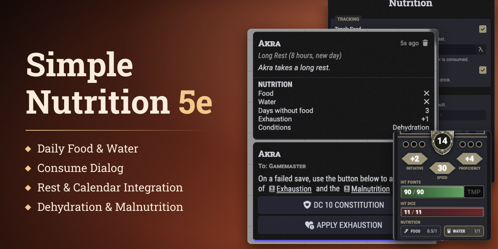
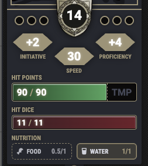
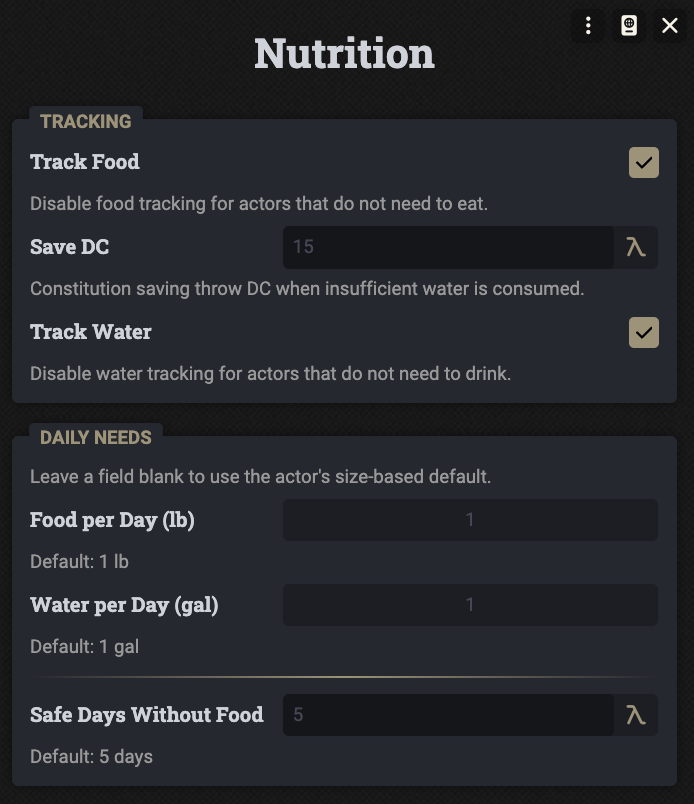
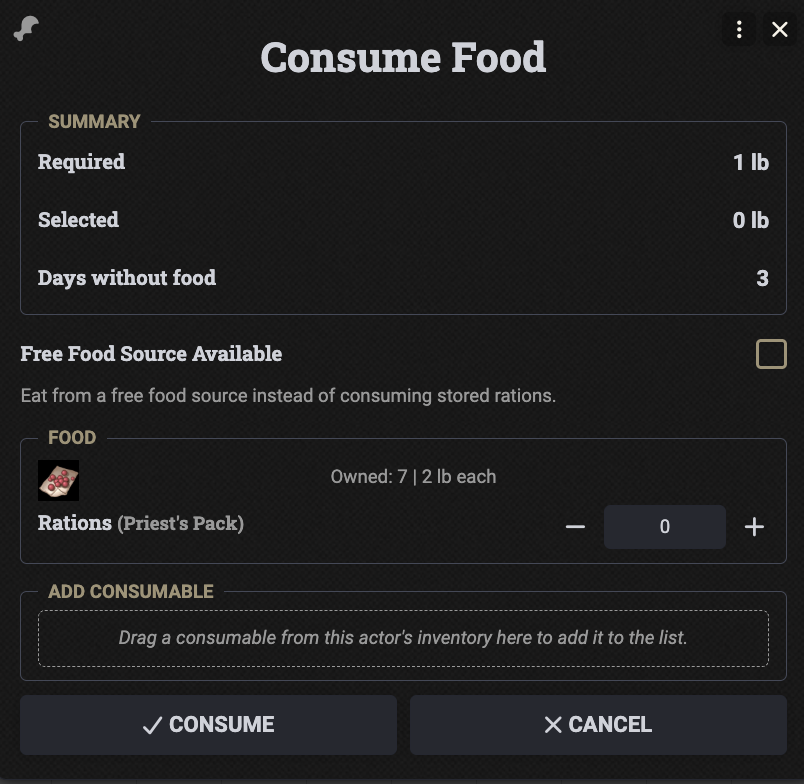
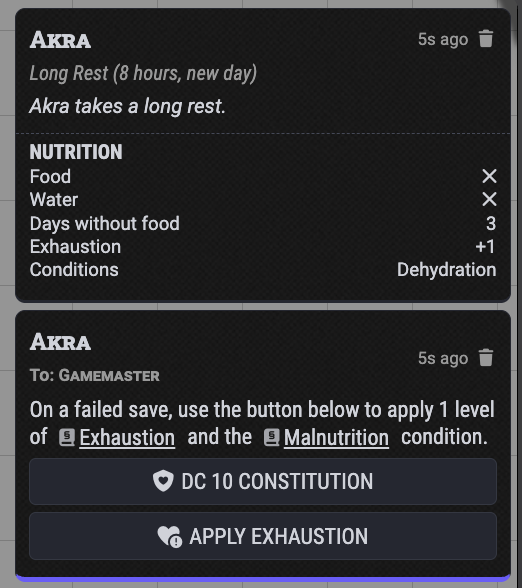
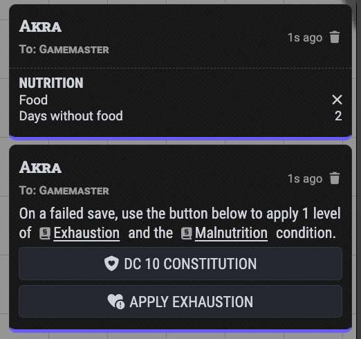

**Simple Nutrition 5e** tracks daily food and water for dnd5e characters and applies the rest consequences
of dehydration and malnutrition.

Every character gets a Nutrition tracker on the character sheet. Players record what their character eats
and drinks, and the module checks each day's totals on a long rest or at the next calendar midnight.

Both the 2024 and the Legacy (2014) rules are supported. The module picks the ruleset from dnd5e's rules
version.

## Contents

- [Getting Started](#getting-started)
- [Tracking](#tracking)
- [Consuming](#consuming)
- [Rest & Calendar](#rest--calendar)
- [Conditions](#conditions)
- [Settings](#settings)
- [Credits & License](#credits--license)

---

## Getting Started

Open a character sheet. The Nutrition tracker sits below the meters, with one button for Food and one for
Water. Click a button to record what the character ate or drank today.

Daily requirements follow the character's size. A Medium character needs 1 lb of food and 1 gallon of water
a day. Weights and volumes follow the dnd5e display settings, so a metric world sees kilograms and liters.

---

## Tracking

Food and water are tracked per character and per day.

- **Progress.** Each button shows how much of today's requirement is met. Its tooltip lists the amount
  consumed and the amount required.
- **Tidy 5e Sheets.** Tidy 5e shows compact Food and Water buttons in the sheet header.
- **Configuration.** In sheet edit mode, a cog button next to the tracker opens the Nutrition configuration.
- **Track Food and Track Water.** Each can be switched off per character, for creatures that need no food or
  no water. The matching button then shows N/A and stays disabled.
- **Overrides.** Food per Day, Water per Day, Days Without Food, and Save DC replace the defaults for one
  character. Days Without Food, called Safe Days Without Food under the Legacy rules, and Save DC accept
  formulas, such as 3 + @abilities.con.mod. A blank field keeps the default.
- **Defaults.** Amounts follow the character's size. The 2024 rules allow 5 days without food, the Legacy
  rules 3 days plus the Constitution modifier, at least 1. The Save DC is 10 under the 2024 rules and 15
  under the Legacy rules.

<table>
  <tr>
    <td width="35%">
      <strong>Daily tracking</strong> 
      
    </td>
    <td width="65%">
      <strong>Nutrition configuration</strong> 
      
    </td>
  </tr>
</table>

---

## Consuming

Click Food or Water on the tracker to open the Consume Food or Drink Water dialog.

- **Required and Selected.** The dialog shows the day's requirement and the amount picked so far. For food,
  it also shows the Days without food counter once it is above 0.
- **Items.** The character's matching consumables are listed with an Owned count and a stepper each. Food
  counts by the item's weight. Water counts one pint per item. A water pint only counts while it sits in a
  Waterskin, while fresh water pints count anywhere in the inventory.
- **Magical berries.** They count as a full day's food.
- **Add Consumable.** Drag a consumable from the character's inventory into the dialog to add it to the
  list.
- **Fresh Water Source Available.** Drinks from a fresh water source without spending carried water and
  fills the day's water requirement.
- **Free Food Source Available.** Eats without spending items, such as a tavern meal, and fills the day's
  food requirement.
- **Consume.** Subtracts the picked quantities from the inventory and adds the amount to today's total.
- **Manage Food and Manage Water.** Once food or water is recorded today, the button opens a choice
  instead. Consume More adds to today's total, and Clear Food or Clear Water resets it. Clearing brings back
  a Dehydration or Malnutrition condition that the intake had removed.

<table>
  <tr>
    <td>
      <strong>Consume dialog</strong> 
      
    </td>
  </tr>
</table>

---

## Rest & Calendar

Nutrition is checked once per day. When that happens depends on the Calendar Mode setting, see
[Settings](#settings).

### Day Check

- **Long rest.** Without a calendar source, a long rest that starts a new day checks the day. Exhaustion is
  added to the rest result, and the rest chat card gains a nutrition summary.
- **Calendar.** With a calendar source, every in-game midnight checks the day instead, and a long rest no
  longer does. The active GM's client does the work and whispers the summary to the character's owners.
- **Characters.** The primary party's characters are checked when a primary party is set, otherwise every
  character is.
- **Time jumps.** Jumping across several midnights at once counts as one day.

### 2024 Rules

- **Water.** Drinking less than half of the requirement applies 1 level of Exhaustion automatically, along
  with the Dehydration condition.
- **Food.** Eating less than half calls for a Constitution saving throw. Days without any food are counted.
  On the day the count reaches Days Without Food, 5 by default, 1 level of Exhaustion applies automatically
  along with the Malnutrition condition, and the save is skipped.
- **Half or more.** Eating or drinking at least half of the requirement has no effect of its own.

### Legacy Rules

- **Food.** A day with less than half of the food adds 1 to Days without food, a day with at least half but
  not all adds 0.5, and a full day resets it to 0. Each day the counter is above Safe Days Without Food
  applies 1 level of Exhaustion automatically.
- **Water.** Drinking less than half applies Exhaustion automatically, 2 levels instead of 1 if the
  character is already exhausted. Drinking at least half but not all calls for a Constitution saving throw,
  and a failed save deals the same 1 or 2 levels.
- **Recovery.** Exhaustion that a shortfall caused cannot be removed by a long rest until both food and water
  have been met in full for a day. This holds in calendar mode as well.

### Saving Throws & Summary

- **Saving throw.** A chat card with a Constitution saving throw button and an Apply Exhaustion button goes to
  the character's owners. The roll button shows the pass or fail result, and it always rolls for the
  character the request is for.
- **Apply Exhaustion.** After a failed save, applies the Exhaustion levels and, under the 2024 rules, the
  Malnutrition condition. Under the Legacy rules it also blocks Exhaustion recovery.
- **Summary.** Lists the missed requirements, Days without food, Exhaustion +N, and the conditions. It sits
  on the rest card in long rest mode and is its own chat message in calendar mode. It is skipped when both
  requirements are met.

<table>
  <tr>
    <td width="50%">
      <strong>Long rest mode</strong> 
      
    </td>
    <td width="50%">
      <strong>Calendar mode</strong> 
      
    </td>
  </tr>
</table>

---

## Conditions

- **2024 rules.** The Dehydration and Malnutrition conditions stand for blocked Exhaustion recovery. While
  one applies, dnd5e keeps a rest from reducing Exhaustion. The condition is removed as soon as the
  character records the full daily requirement of its type.
- **Legacy rules.** There are no matching conditions. The module blocks the Exhaustion recovery itself, see
  [Legacy Rules](#legacy-rules).
- **Tracking off.** Conditions of a type that is not tracked are left alone, so manually set ones stay.
- **Existing Exhaustion.** The module only adds Exhaustion. Removing it follows the normal dnd5e workflow.

---

## Settings

One world setting is available in the module settings.

- **Calendar Mode.** Chooses whether nutrition is checked once per calendar midnight or on a long rest that
  starts a new day. Default (Auto-Detect) treats Calendaria, Ember, or dnd5e's Daily Recovery Mode set to
  Calendar Recovery, which needs dnd5e 6.0 or later, as a calendar source. It switches to calendar mode as
  soon as one is present. Set it to Always On or Always Off to decide by hand.

---

## Credits & License

- **License.** Released under the [MIT License](LICENSE).
- **Font.** The banner uses [Roboto Slab](https://fonts.google.com/specimen/Roboto+Slab) under the Apache
  License 2.0.
